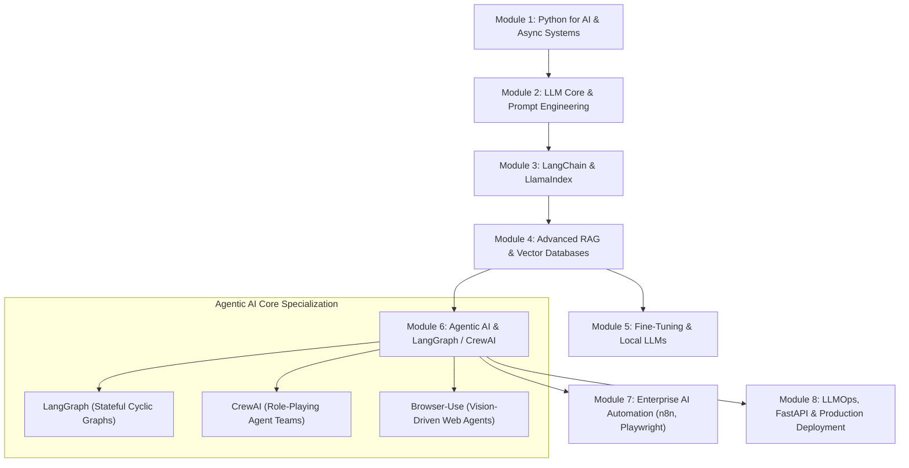

# 🤖 Dedicated Roadmap: AI Engineer, GenAI & Agentic Systems (2025–2026)
> **ফোল্ডার:** `dev-guides/track-02-genai/`  
> **লক্ষ্য:** প্রথাগত ডেটা সায়েন্স ও জটিল গণিত ছাড়াই সরাসরি আধুনিক **Generative AI, Large Language Models (LLMs), LangChain, LlamaIndex, Advanced RAG, LangGraph, CrewAI, এবং AI Automation**-এ দক্ষ হয়ে প্রফেশনাল **AI Engineer / Agent Developer** হিসেবে নিজেকে গড়ে তোলা।

---

## 🧭 হাই-লেভেল লার্নিং পাথ (Visual Architecture)

---

## 📌 মডিউল-বাই-মডিউল বিস্তারিত চেকলিস্ট ও স্টাডি গাইড

---

### 🟢 Module 1: Python for AI Engineers & Async Architecture
*সময়: ১-২ সপ্তাহ* | 📖 **[এই মডিউলের বিস্তারিত স্টাডি গাইড ও ল্যাব পড়ুন](./docs/ai-engineering/01-python-async.md)**
> এআই ইঞ্জিনিয়ারিংয়ের জন্য পাইথনের যে অংশগুলো সবচেয়ে বেশি দরকার।

- [ ] **Type Hints & Modern Python (3.11+):** টাইপ চেকিং, ডেটাক্লাস (`dataclass`)।
- [ ] **Pydantic v2 Mastery:** ডাটা ভ্যালিডেশন, স্কিমা তৈরি, সিরিয়ালাইজেশন (LLM Structured Outputs-এর ভিত্তি)।
- [ ] **AsyncIO & Concurrency:** `async`, `await`, `asyncio.gather()`, `httpx` (বহু এআই রিকোয়েস্ট একসাথে দ্রুত হ্যান্ডেল করা)।
- [ ] **API Fundamentals:** REST APIs, Server-Sent Events (SSE / Streaming), Webhooks, JSON parsing।
- [ ] **Environment & Dependency Management:** `uv` অথবা `poetry`, `.env` ফাইল হ্যান্ডলিং, Git/GitHub।

---

### 🔵 Module 2: LLM Core, Prompt Engineering & Tool Calling
*সময়: ২ সপ্তাহ* | 📖 **[এই মডিউলের বিস্তারিত স্টাডি গাইড ও ল্যাব পড়ুন](./docs/ai-engineering/02-llm-core-prompting.md)**
> এলএলএম কীভাবে কাজ করে এবং মডেলগুলোকে সঠিকভাবে নিয়ন্ত্রণ করার কৌশল।

- [ ] **LLM আর্কিটেকচার বেসিক্স:** টোকেন (Tokens), কনটেক্সট উইন্ডো (Context Window), টেম্পারেচার (Temperature), Top-P, Top-K।
- [ ] **Foundation Model APIs:** OpenAI (GPT-4o), Anthropic (Claude 3.5 Sonnet), Google Gemini, DeepSeek, Mistral।
- [ ] **Advanced Prompt Engineering:**
  - [ ] Few-Shot Prompting, Chain-of-Thought (CoT), Self-Consistency, ReAct (Reason + Act)।
  - [ ] System Prompt Architecture & Guardrail Instructions।
- [ ] **Function Calling & Native Tool Calling:**
  - [ ] এআই-কে নিজস্ব পাইথন ফাংশন বা ক্যালকুলেটর এক্সেস দেওয়া।
  - [ ] Structured Outputs (Pydantic / JSON Mode দিয়ে ১০০% স্ট্রাকচার্ড ডাটা বের করা)।
- [ ] **Local LLM Execution:**
  - [ ] **Ollama:** পিসিতে LLaMA 3, Mistral, DeepSeek মডেল লোকালি রান করা ও API হিসেবে ব্যবহার।
  - [ ] **LM Studio / vLLM** বেসিক্স।

🎯 **মাইলস্টোন প্রজেক্ট ১:** Multi-LLM Smart Fallback API Wrapper (যদি OpenAI ফেইল করে তবে স্বয়ংক্রিয়ভাবে Claude বা Ollama-তে সুইচ করবে এবং Pydantic দিয়ে ক্লিন ডাটা রিটার্ন করবে)।

---

### 🟣 Module 3: Frameworks — LangChain & LlamaIndex
*সময়: ২-৩ সপ্তাহ* | 📖 **[এই মডিউলের বিস্তারিত স্টাডি গাইড ও ল্যাব পড়ুন](./docs/ai-engineering/03-langchain-llamaindex.md)**
> এআই অ্যাপ্লিকেশনের সবচেয়ে জনপ্রিয় দুটি ফ্রেমওয়ার্ক।

- [ ] **LangChain Deep Dive:**
  - [ ] **LCEL (LangChain Expression Language):** পাইপ অপারেটর (`|`) দিয়ে চেইন তৈরি।
  - [ ] Prompt Templates, Chat Models, Output Parsers।
  - [ ] Memory: Buffer Memory, Summary Memory, VectorStore Memory।
  - [ ] Runnables: `RunnablePassthrough`, `RunnableParallel`, `RunnableLambda`।
  - [ ] Callbacks & Event Streaming (লাইভ টোকেন প্রিন্ট করা)।
- [ ] **LlamaIndex Essentials:**
  - [ ] Document Loaders (PDF, Notion, Web, SQL)।
  - [ ] Node Parsers & Text Splitters।
  - [ ] Indexing (VectorStoreIndex, SummaryIndex, KnowledgeGraphIndex)।
  - [ ] Query Engines ও Chat Engines।
- [ ] **LangChain vs LlamaIndex সিদ্ধান্ত:** কোন প্রজেক্টে কোনটি ব্যবহার করবেন তার স্পষ্ট ধারণা।

---

### 🟠 Module 4: Advanced RAG (Retrieval-Augmented Generation) & Vector DBs
*সময়: ৩-৪ সপ্তাহ* | 📖 **[এই মডিউলের বিস্তারিত স্টাডি গাইড ও ল্যাব পড়ুন](./docs/ai-engineering/04-advanced-rag.md)**
> বর্তমান এআই ইন্ডাস্ট্রির মোস্ট ডিমান্ডিং প্রজেক্ট এরিয়া।

- [ ] **Chunking Strategies:**
  - [ ] Fixed-size, Recursive Character, Semantic Chunking, Parent-Document Chunking।
- [ ] **Embeddings:**
  - [ ] OpenAI `text-embedding-3`, BAAI/BGE-M3, Cohere Embed v3, Hugging Face local embeddings।
- [ ] **Vector Databases:**
  - [ ] **ChromaDB:** লোকাল প্রোটোটাইপিংয়ের জন্য।
  - [ ] **Qdrant:** হাই-পারফরম্যান্স প্রোডাকশন রেডি ভেক্টর ডাটাবেস (Payload filtering সহ)।
  - [ ] **Pinecone / pgvector:** ক্লাউড ও PostgreSQL ভেক্টর স্টোরেজ।
- [ ] **Advanced RAG Techniques (Industry Standard):**
  - [ ] **Hybrid Search:** Dense Vector Search + Sparse Keyword Search (BM25)।
  - [ ] **Re-ranking:** Cohere Rerank / BGE-Reranker দিয়ে টপ রেজাল্ট ফিল্টার করা।
  - [ ] **Query Transformation:** Multi-Query Generation, Sub-Question Querying, HyDE (Hypothetical Document Embeddings)।
  - [ ] **Contextual Compression:** অপ্রয়োজনীয় টেক্সট বাদ দিয়ে প্রম্পট খরচ কমানো।
- [ ] **RAG Evaluation:** **Ragas** অথবা **TruLens** দিয়ে বিশ্বস্ততা (Faithfulness) ও রিলেভেন্স পরিমাপ।

🎯 **মাইলস্টোন প্রজেক্ট ২:** Enterprise Document Intelligence RAG System (মাল্টিপল পিডিএফ আপলোড করে সাইটেশন এবং সোর্স পেজ নম্বরসহ নিখুঁত উত্তর দেওয়ার ইন্টারঅ্যাক্টিভ ওয়েব চ্যাটবট)।

---

### 🟡 Module 5: Open-Source LLMs & Fine-Tuning
*সময়: ১-২ সপ্তাহ* | 📖 **[এই মডিউলের বিস্তারিত স্টাডি গাইড ও ল্যাব পড়ুন](./docs/ai-engineering/05-finetuning-local-llms.md)**
> নিজের স্পেসিফিক ডোমেইনের জন্য মডেল কাস্টমাইজ করা।

- [ ] **Fine-Tuning কখন প্রয়োজন?** Prompting vs RAG vs Fine-Tuning ডিসিশন ম্যাট্রিক্স।
- [ ] **PEFT (Parameter-Efficient Fine-Tuning):**
  - [ ] LoRA (Low-Rank Adaptation) ও QLoRA (4-bit Quantized LoRA)।
- [ ] **Unsloth:**
  - [ ] ৮০% কম মেমোরি ও ৫ গুণ দ্রুত গতিতে LLaMA 3 / Mistral ফাইন-টিউনিং।
- [ ] **Dataset Preparation:**
  - [ ] ইনস্ট্রাকশন ডেটাসেট তৈরি ও ফরম্যাটিং (Alpaca / ShareGPT format)।
  - [ ] মডেল এক্সপোর্ট (GGUF ফরম্যাটে এক্সপোর্ট করে Ollama দিয়ে রান করা)।

---

### 🔴 Module 6: Agentic AI, LangGraph & Multi-Agent Systems
*সময়: ৩-৪ সপ্তাহ* | 📖 **[এই মডিউলের বিস্তারিত স্টাডি গাইড ও ল্যাব পড়ুন](./docs/ai-engineering/06-agentic-langgraph.md)**
> আধুনিক এআই-এর শীর্ষ প্রযুক্তি — স্বয়ংক্রিয় এজেন্ট যারা নিজেই চিন্তা করে ও কাজ করে।

- [ ] **এজেন্টের মূল মেকানিজম:**
  - [ ] Reasoning (ReAct লুপ), Planning, Memory, Tool Calling, Self-Reflection/Self-Correction।
- [ ] **LangGraph (ইন্ডাস্ট্রি লিডার ও ফিউচার):**
  - [ ] StateGraph আর্কিটেকচার (State, Nodes, Edges, Conditional Edges)।
  - [ ] সাইক্লিক লুপ ও এরর হ্যান্ডলিং (এআই নিজে কোড লিখে রান করবে, এরর আসলে ঠিক করে আবার রান করবে)।
  - [ ] **Persistence & Checkpointing:** এজেন্টের পূর্বের স্টেট সেভ রাখা ও টাইম ট্রাভেল।
  - [ ] **Human-in-the-Loop:** গুরুত্বপূর্ণ অ্যাকশনের আগে মানুষের অনুমোদন (Approval Gate) নেওয়া।
  - [ ] মাল্টি-এজেন্ট প্যাটার্ন: Supervisor-Worker আর্কিটেকচার, Hierarchical Team।
- [ ] **CrewAI:**
  - [ ] Role-playing Framework (Agent Role, Goal, Backstory)।
  - [ ] Tasks, Tools, Delegation (এজেন্টদের মধ্যে কাজ ভাগ করে দেওয়া)।
  - [ ] Sequential vs Hierarchical Process।
- [ ] **Vision & Browser Agents:**
  - [ ] **Browser-Use:** এআই সরাসরি ক্রোম ব্রাউজার খুলে ক্লিক, টাইপ ও স্ক্র্যাপ করবে।

🎯 **মাইলস্টোন প্রজেক্ট ৩:** Autonomous Software Engineer / Research Team:
- Agent 1 (Researcher): গুগল ও গিটহাব সার্চ করে টেকনিক্যাল সল্যুশন খুঁজবে।
- Agent 2 (Coder): পাইথন কোড লিখবে ও টেস্ট ফাইল বানাবে।
- Agent 3 (Tester): কোড এক্সিকইউট করবে, বাগ পেলে Coder-এর কাছে রি-সাবমিট করবে।
- Human Supervisor: ফাইনাল কোড দেখে অনুমোদন দেবে।

---

### 🌐 Module 7: Enterprise AI Automation & Workflow Tools
*সময়: ২ সপ্তাহ* | 📖 **[এই মডিউলের বিস্তারিত স্টাডি গাইড ও ল্যাব পড়ুন](./docs/ai-engineering/07-enterprise-automation.md)**
> এআই এজেন্টকে বাস্তব ব্যবসায়িক সিস্টেমে অটোমেট করা।

- [ ] **n8n (Self-Hosted AI Workflow Automation):**
  - [ ] n8n-এ LangChain AI Agent Node কনফিগার করা।
  - [ ] Vector Store ও Memory Node যুক্ত করা।
  - [ ] Webhook ট্রিগার (যেমন: নতুন ইমেইল বা ফর্ম সাবমিট হলে স্বয়ংক্রিয় এআই ওয়ার্কফ্লো চালু হওয়া)।
- [ ] **Web Automation & Scraping for AI:**
  - [ ] **Playwright (Python):** হেডলেস ব্রাউজার হ্যান্ডলিং, ডায়নামিক পেজ অটোমেশন।
  - [ ] **Crawl4AI:** ওপেন-সোর্স এআই-ফ্রেন্ডলি ক্রলার যা সম্পূর্ণ ওয়েবপেজকে ক্লিন মার্কডাউন ডাটাতে কনভার্ট করে।
- [ ] **Integration with SaaS:**
  - [ ] Google Workspace, Slack, Telegram, Notion, Airtable, HubSpot CRM-এর সাথে এআই এজেন্টের সংযোগ।

🎯 **মাইলস্টোন প্রজেক্ট ৪:** Full Automated AI Lead Research & CRM Sync:
- Crawl4AI দিয়ে কোম্পানির ওয়েবসাইট ক্রল করা।
- LLM দিয়ে কোম্পানির অফারিং এবং কন্টাক্ট পার্সন খুঁজে বের করা।
- n8n দিয়ে স্বয়ংক্রিয়ভাবে CRM-এ ডাটা সেভ করা এবং পার্সোনালাইজড ইমেইল ড্রাফট তৈরি করা।

---

### ⚙️ Module 8: Production AI Engineering, FastAPI & LLMOps
*সময়: ২-৩ সপ্তাহ* | 📖 **[এই মডিউলের বিস্তারিত স্টাডি গাইড ও ল্যাব পড়ুন](./docs/ai-engineering/08-production-llmops.md)**
> তৈরি করা এআই সিস্টেমকে প্রোডাকশনে স্কেলেবলভাবে ডেপ্লয় করা।

- [ ] **FastAPI Backend:**
  - [ ] Async Endpoints ও Pydantic Validation।
  - [ ] **Streaming Responses (SSE):** টাইপিং ইফেক্ট বা রিয়েল-টাইম টোকেন স্ট্রিমিং।
  - [ ] Background Tasks ও Rate Limiting।
- [ ] **LLMOps, Observability & Tracing:**
  - [ ] **Langfuse:** প্রম্পট ম্যানেজমেন্ট, টোকেন খরচ, রেসপন্স লেটেন্সি এবং সম্পূর্ণ এজেন্ট এক্সিকিউশন গ্রাফ ট্রেস করা।
  - [ ] **Guardrails:** NeMo Guardrails বা Pydantic দিয়ে প্রম্পট ইনজেকশন ঠেকানো ও সেনসিটিভ ডাটা মাস্কিং।
- [ ] **Production Serving & Deployment:**
  - [ ] **Docker & Docker Compose:** সম্পূর্ণ এআই অ্যাপ + Qdrant + Redis কনটেইনারে প্যাক করা।
  - [ ] **vLLM:** প্রোডাকশন সার্ভারে ওপেন-সোর্স মডেল হাই-থ্রুপুটে হোস্ট করা।
  - [ ] ক্লাউড ডেপ্লয়মেন্ট: Render, Railway, AWS ECS/Bedrock, অথবা Hugging Face Spaces।

🎯 **মাইলস্টোন প্রজেক্ট ৫ (ক্যাপস্টোন):** Production-Ready Multi-Agent API Microservice (Dockerized FastAPI + LangGraph Multi-Agent Engine + Qdrant Vector Search + Langfuse Live Observability)।

---

## 🛠️ Essential Tech Stack Summary

| ক্যাটাগরি | শীর্ষ টুলস ও ফ্রেমওয়ার্ক |
| :--- | :--- |
| **Language** | Python 3.11+, Pydantic v2, AsyncIO |
| **LLM APIs** | OpenAI (GPT-4o), Anthropic (Claude 3.5), DeepSeek, Gemini |
| **Local LLM Engine** | Ollama, vLLM |
| **Frameworks** | LangChain (LCEL), LlamaIndex |
| **Agentic Frameworks** | **LangGraph**, **CrewAI**, AutoGen, Browser-Use |
| **Vector Databases** | **Qdrant**, ChromaDB, Pinecone |
| **RAG Advanced** | Cohere Rerank, BM25 Hybrid, Ragas |
| **Fine-Tuning** | Unsloth, Hugging Face PEFT (LoRA/QLoRA) |
| **Automation** | **n8n**, Crawl4AI, Playwright |
| **Backend & Observability**| **FastAPI**, **Langfuse**, Docker |

---

## 🎓 সেরা ফ্রি শেখার রিসোর্স (Curated Resources)

1. **LangGraph Official Academy:** DeepLearning.AI & LangChain-এর নিজস্ব ফ্রি কোর্স।
2. **LangChain & LlamaIndex Docs:** অফিসিয়াল কুকবুক ও ডকুমেন্টেশন।
3. **DeepLearning.AI Short Courses:** Andrew Ng-এর প্ল্যাটফর্মে LangChain, CrewAI, AutoGen, Prompt Engineering-এর ওপর চমৎকার ফ্রি কোর্স।
4. **YouTube Channels:** 
   - *James Briggs* (Vector DB, LangChain, RAG)
   - *Dave Ebbelaar* (LangGraph, AI Engineering)
   - *Matthew Berman* (Latest LLMs, Local AI, Agent Tools)
5. **n8n Academy:** n8n-এর ফ্রি ওয়ার্কফ্লো অটোমেশন সার্টিফিকেশন।
