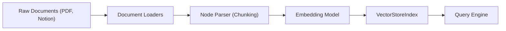

# 📘 অধ্যায় ৩: Frameworks — LangChain & LlamaIndex
> **বইয়ের ট্র‍্যাক:** AI Engineer, GenAI & Agentic Systems (Track 2)  
> **মডিউল:** ০৩ | এআই ফ্রেমওয়ার্কস: LCEL পাইপলাইন, ডকুমেন্ট ইনজেশন ও কুয়েরি ইঞ্জিন  
> **উদ্দেশ্য:** আধুনিক অ্যাপ্লিকেশন ডেভেলপমেন্টের জন্য LangChain ও LlamaIndex-কে লেগো ব্লকের মতো সমন্বয় করা।

---

## 📑 সূচিপত্র (Table of Contents)
1. [ভূমিকা: এআই ফ্রেমওয়ার্ক কেন দরকার?](#১-ভূমিকা-এআই-ফ্রেমওয়ার্ক-কেন-দরকার)
2. [টপিক ১: LangChain ও LCEL (LangChain Expression Language)](#২-টপিক-১-langchain-ও-lcel)
3. [টপিক ২: Runnables ও পাইপলাইন আর্কিটেকচার](#৩-টপিক-২-runnables-ও-পাইপলাইন-আর্কিটেকচার)
4. [টপিক ৩: LlamaIndex — Data Ingestion ও Indexing](#৪-টপিক-৩-llamaindex--data-ingestion-ও-indexing)
5. [টপিক ৪: Query Engine বনাম Chat Engine](#৫-টপিক-৪-query-engine-বনাম-chat-engine)
6. [টপিক ৫: LangChain বনাম LlamaIndex নির্বাচন গাইড](#৬-টপিক-৫-langchain-বনাম-llamaindex-নির্বাচন-গাইড)
7. [🛠️ হ্যান্ডস-অন ল্যাব: এন্ড-টু-এন্ড ডকুমেন্ট কুয়েরি পাইপলাইন](#৭-হ্যান্ডস-অন-ল্যাব-এন্ড-টু-এন্ড-ডকুমেন্ট-কুয়েরি-পাইপলাইন)

---

## ১. ভূমিকা: এআই ফ্রেমওয়ার্ক কেন দরকার?

সরাসরি OpenAI বা Anthropic-এর এপিআই কল করে ছোটখাটো কাজ করা সম্ভব হলেও, প্রোডাকশন-গ্রেড এআই অ্যাপ্লিকেশনে একাধিক কাজ একসাথে করতে হয়:
1. একাধিক মডেলের সাথে চ্যাট হিস্ট্রি মেনটেইন করা।
2. পিডিএফ বা ডাটাবেস থেকে টেক্সট ভেঙে ভেক্টরে কনভার্ট করা।
3. আউটপুট ভ্যালিডেশন এবং এরর হলে ফলব্যাক চালানো।

এসব জটিল মেকানিজম স্ক্র্যাচ থেকে বারবার না লিখে স্ট্যান্ডার্ড আর্কিটেকচার দেয় **LangChain** এবং **LlamaIndex**।

---

## ২. টপিক ১: LangChain ও LCEL (LangChain Expression Language)

### ২.১ LCEL কী?
LCEL হলো LangChain-এর আধুনিক পাইপলাইন সিনট্যাক্স। ইউনিক্স টার্মিনালের মতো পাইপ (`|`) অপারেটর দিয়ে এক কম্পোনেন্টের আউটপুটকে অন্য কম্পোনেন্টের ইনপুট হিসেবে পাস করা হয়:

```python
# LCEL চেইনের সাধারণ রূপ
chain = prompt | model | output_parser
```

### ২.২ একটি সম্পূর্ণ LCEL চেইন কোড:
```python
from langchain_core.prompts import ChatPromptTemplate
from langchain_core.output_parsers import StrOutputParser
from langchain_openai import ChatOpenAI

# ১. প্রম্পট টেমপ্লেট
prompt = ChatPromptTemplate.from_messages([
    ("system", "You are an expert software tutor. Answer in Bengali concisely."),
    ("user", "Explain what {concept} is with a simple real-world analogy.")
])

# ২. মডেল
llm = ChatOpenAI(model="gpt-4o", temperature=0.3)

# ৩. আউটপুট পার্সার
parser = StrOutputParser()

# ৪. LCEL পাইপলাইন চেইন তৈরি
chain = prompt | llm | parser

# ৫. ইনভোক করা
result = chain.invoke({"concept": "Docker Container"})
print(result)
```

### ২.৩ স্ট্রিমিং রেসপন্স (লাইভ টাইপিং ইফেক্ট):
LCEL-এর সবচেয়ে বড় সুবিধা হলো এটি নেটিভলি স্ট্রিমিং ও অ্যাসিঙ্ক সাপোর্ট করে:
```python
import asyncio

async def stream_output():
    async for chunk in chain.astream({"concept": "Microservices"}):
        print(chunk, end="", flush=True)

# asyncio.run(stream_output())
```

---

## ৩. টপিক ২: Runnables ও পাইপলাইন আর্কিটেকচার

LangChain-এ প্রতিটি কম্পোনেন্ট হলো একটি `Runnable`। এদের মাধ্যমে প্যারালাল বা শর্তসাপেক্ষ কাজ করা যায়:

* `RunnablePassthrough`: ইউজারের অরিজিনাল ইনপুট অপরিবর্তিত রেখে পরবর্তী ধাপে পাঠিয়ে দেওয়া।
* `RunnableParallel`: একই সময়ে মডেলের কাছে দুটি আলাদা কাজ পাঠানো।
* `RunnableLambda`: সাধারণ যেকোনো পাইথন ফাংশনকে চেইনের মাঝখানে বসিয়ে দেওয়া।

```python
from langchain_core.runnables import RunnableParallel, RunnablePassthrough

# একসাথে সামারি ও কি-পয়েন্টস তৈরি করার প্যারালাল চেইন
summary_chain = prompt_summary | llm | parser
keypoints_chain = prompt_points | llm | parser

combined_chain = RunnableParallel({
    "summary": summary_chain,
    "key_points": keypoints_chain,
    "original_query": RunnablePassthrough()
})
```

---

## ৪. টপিক ৩: LlamaIndex — Data Ingestion ও Indexing

### ৪.১ LlamaIndex কেন?
LangChain লজিক ও চেইনিংয়ের জন্য দারুণ, কিন্তু ডকুমেন্ট পড়া, প্যারাগ্রাফে ভাঙা এবং পারফেক্ট সার্চ ইনডেক্সিংয়ের জন্য **LlamaIndex** বর্তমান ইন্ডাস্ট্রির সেরা ডেটা ফ্রেমওয়ার্ক।



### ৪.২ ডকুমেন্ট লোডিং ও ইনডেক্সিং:
```python
from llama_index.core import SimpleDirectoryReader, VectorStoreIndex
from llama_index.llms.openai import OpenAI

# ১. ডিরেক্টরি থেকে সব ফাইল (PDF, TXT, DOCX) লোড করা
documents = SimpleDirectoryReader("./data_files").load_data()

# ২. স্বয়ংক্রিয়ভাবে চাঙ্ক তৈরি এবং ভেক্টর ইনডেক্স গঠন
index = VectorStoreIndex.from_documents(documents)

# ৩. ইনডেক্স ডিস্কে সেভ করা (Persistence)
index.storage_context.persist(persist_dir="./storage")
```

---

## ৫. টপিক ৪: Query Engine বনাম Chat Engine

LlamaIndex-এ দুটি উপায়ে ডেটা নিয়ে কাজ করা যায়:

1. **Query Engine (Q&A):** স্টেটলেস। ইউজার প্রশ্ন করবে, ডকুমেন্ট থেকে উত্তর আসবে। কোনো পূর্ববর্তী হিস্ট্রি থাকে না।
   ```python
   query_engine = index.as_query_engine(similarity_top_k=3)
   response = query_engine.query("কোম্পানির রিফান্ড পলিসি কী?")
   print(response)
   ```
2. **Chat Engine (Conversation):** স্টেটফুল। মেমোরি ধরে রাখে, ফলে আগের আলোচনার রেশ ধরে প্রশ্ন করা যায়।
   ```python
   chat_engine = index.as_chat_engine(chat_mode="condense_question")
   res1 = chat_engine.chat("আমার প্যাকেজ নষ্ট হলে কী পাব?")
   res2 = chat_engine.chat("কত দিনের মধ্যে আবেদন করতে হবে?") # আগের প্রশ্ন মনে রাখবে
   ```

---

## ৬. টপিক ৫: LangChain বনাম LlamaIndex নির্বাচন গাইড

| মাপকাঠি | LangChain | LlamaIndex |
| :--- | :--- | :--- |
| **মূল শক্তি** | এজেন্টস, মাল্টি-স্টেপ ওয়ার্কফ্লো, টুল কলিং | ডেটা কানেক্টর, অ্যাডভান্সড ইনডেক্সিং ও RAG |
| **সিনট্যাক্স স্টাইল** | পাইপলাইন ও ফাংশনাল (`\|`) | অবজেক্ট ওরিয়েন্টেড ও ডাটা-সেন্ট্রিক |
| **আউটপুট পার্সিং** | শক্তিশালী Pydantic পার্সার ও স্ট্রাকচার্ড ডাটা | ডকুমেন্ট নোড ও মেটাডাটা হ্যান্ডলিং |
| **কখন বেছে নেবেন?** | যখন স্বয়ংক্রিয় চ্যাটবট বা এআই এজেন্ট তৈরি করবেন | যখন বিশাল নলেজ বেস থেকে সার্চ বা প্রশ্ন-উত্তর করবেন |
| **প্রোডাকশন সেরা প্র্যাকটিস** | **দুটিকে একসাথে ব্যবহার:** ডেটা ফেচ ও ইনডেক্সিংয়ের জন্য LlamaIndex, আর ডিসিশন মেকিংয়ের জন্য LangChain! |

---

## 🛠️ ৭. হ্যান্ডস-অন ল্যাব: এন্ড-টু-এন্ড ডকুমেন্ট কুয়েরি পাইপলাইন

**উদ্দেশ্য:** একটি পাইথন স্ক্রিপ্ট তৈরি করুন যা একটি টেক্সট ফাইল লোড করবে এবং সোর্স টেক্সটের রেফারেন্সসহ উত্তর প্রদান করবে।

```python
from llama_index.core import Document, VectorStoreIndex

# সিমুলেটেড ডাটা ডকুমেন্ট
sample_text = """
Antigravity AI Platform 2026 Guidelines:
1. All AI microservices must use asynchronous endpoints with FastAPI.
2. Vector databases must use Qdrant for scalable search.
3. Every agent pipeline must implement Langfuse observability for cost tracking.
"""

doc = Document(text=sample_text, metadata={"source": "engineering_handbook_v2"})

# ইনডেক্স তৈরি
index = VectorStoreIndex.from_documents([doc])

# কুয়েরি ইঞ্জিন রান
query_engine = index.as_query_engine()
response = query_engine.query("What vector database should we use according to guidelines?")

print("🤖 উত্তর:", response.response)
print("📄 সোর্স মেটাডাটা:", [node.metadata for node in response.source_nodes])
```
