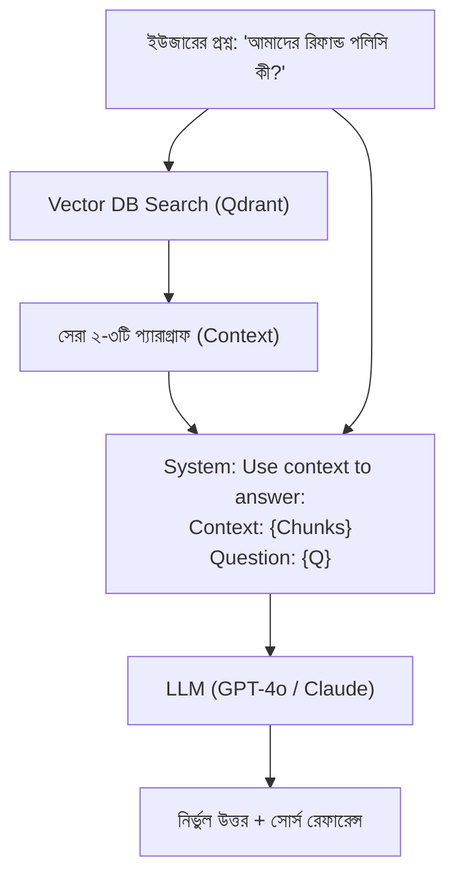

# 📘 অধ্যায় ৪: Advanced RAG & Vector Databases
> **বইয়ের ট্র‍্যাক:** AI Engineer, GenAI & Agentic Systems (Track 2)  
> **মডিউল:** ০৪ | অ্যাডভান্সড আরএজি, ভেক্টর ডাটাবেস, হাইব্রিড সার্চ ও রি-র‍্যাংকিং  
> **উদ্দেশ্য:** বর্তমান এআই ইন্ডাস্ট্রির সবচেয়ে চাহিদাসম্পন্ন নলেজ রিট্রিভাল সিস্টেম তৈরি করা যা হ্যালুসিনেশন ছাড়াই সঠিক উত্তর দেয়।

---

## 📑 সূচিপত্র (Table of Contents)
1. [ভূমিকা: RAG কী এবং কেন দরকার?](#১-ভূমিকা-rag-কী-এবং-কেন-দরকার)
2. [টপিক ১: চাংকিং স্ট্র্যাটেজি (Chunking Strategies)](#২-টপিক-১-চাংকিং-স্ট্র্যাটেজি-chunking-strategies)
3. [টপিক ২: Embeddings ও ভেক্টর গণিত](#৩-টপিক-২-embeddings-ও-ভেক্টর-গণিত)
4. [টপিক ৩: Vector Databases (ChromaDB বনাম Qdrant)](#৪-টপিক-৩-vector-databases-chromadb-বনাম-qdrant)
5. [টপিক ৪: Advanced RAG টেকনিক্স (Hybrid Search & Re-ranking)](#৫-টপিক-৪-advanced-rag-টেকনিক্স)
6. [টপিক ৫: Query Transformation ও HyDE](#৬-টপিক-৫-query-transformation-ও-hyde)
7. [টপিক ৬: RAG Evaluation with Ragas](#৭-টপিক-৬-rag-evaluation-with-ragas)
8. [🎯 মাইলস্টোন প্রজেক্ট ২: Enterprise Document Intelligence RAG](#৮-মাইলস্টোন-প্রজেক্ট-২-enterprise-document-rag)

---

## ১. ভূমিকা: RAG কী এবং কেন দরকার?

### ১.১ ওপেন-বুক পরীক্ষার রূপক
* **সাধারণ এলএলএম:** একজন শিক্ষার্থী যার স্মৃতিশক্তি বিশাল, কিন্তু সে ২০২৪ সালের পরের কোনো ঘটনা বা আপনার অফিসের প্রাইভেট ফাইল চেনে না (ক্লোজড-বুক)।
* **RAG (Retrieval-Augmented Generation):** শিক্ষার্থীকে প্রশ্ন করার পর সে সরাসরি লাইব্রেরি বা ড্রাইভ থেকে সঠিক পাতাটি খুঁজে বের করে এবং সেই পাতাটি চোখের সামনে রেখে প্রশ্নের উত্তর লিখে দেয় (ওপেন-বুক)।



---

## ২. টপিক ১: চাংকিং স্ট্র্যাটেজি (Chunking Strategies)

একটি ৫০০ পৃষ্ঠার বই সরাসরি মডেলে পাঠানো ব্যয়বহুল এবং মডেল মাঝখানের তথ্য ভুলে যেতে পারে (**"Lost in the Middle" সমস্যা**)। এজন্য টেক্সটকে অর্থপূর্ণ টুকরো বা চাঙ্কে ভাগ করা হয়।

### ২.১ Recursive Character Text Splitter (সবচেয়ে জনপ্রিয়)
প্রথমে ডাবল নিউলাইন (`\n\n`), তারপর সিঙ্গেল নিউলাইন (`\n`), তারপর স্পেস (` `) দিয়ে ভাঙে যাতে প্যারাগ্রাফ ও বাক্যের অর্থ অক্ষুণ্ণ থাকে:

```python
from langchain_text_splitters import RecursiveCharacterTextSplitter

text_splitter = RecursiveCharacterTextSplitter(
    chunk_size=500,       # প্রতিটি চাঙ্কে সর্বোচ্চ ৫০০ ক্যারেক্টার
    chunk_overlap=50,     # আগের চাঙ্কের শেষের ৫০ অক্ষর পরের চাঙ্কে থাকবে (কনটেক্সট বজায় রাখতে)
    separators=["\n\n", "\n", " ", ""]
)

chunks = text_splitter.split_text("আপনার দীর্ঘ ডকুমেন্টের টেক্সট...")
```

### ২.২ Semantic Chunking
ক্যারেক্টার গুনে না ভেঙে এম্বেডিং দূরত্বের ভিত্তিতে প্যারাগ্রাফ যখন নতুন বিষয় শুরু করে, তখনই কেবল নতুন চাঙ্ক তৈরি করে।

### ২.৩ Parent-Document (Hierarchical) Chunking
সার্চ করার জন্য ছোট ছোট চাঙ্ক (যেমন ১০০ টোকেন) ভেক্টর ডিবিতে রাখা হয়, কিন্তু এলএলএম-এর কাছে পাঠানোর সময় তার প্যারেন্ট প্যারাগ্রাফ (১০০০ টোকেন) পাঠানো হয়। এটি অসাধারণ অ্যাকুরেসি দেয়।

---

## ৩. টপিক ২: Embeddings ও ভেক্টর গণিত

কম্পিউটার শব্দের অর্থ বোঝে না। এম্বেডিং মডেল যেকোনো টেক্সটকে একটি সংখ্যার তালিকায় (যেমন ১৫৩৬ মাত্রার ভেক্টর) রূপান্তর করে।
* যে দুটি বাক্যের অর্থ কাছাকাছি, ভেক্টর স্পেসে তাদের কোণ বা দূরত্বও কাছাকাছি হয় (**Cosine Similarity**)।

```python
from openai import OpenAI

client = OpenAI()

response = client.embeddings.create(
    input=["কীভাবে এআই ইঞ্জিনিয়ার হওয়া যায়?", "AI engineer roadmap"],
    model="text-embedding-3-small"
)

vector_1 = response.data[0].embedding
print(f"ভেক্টর ডাইমেনশন: {len(vector_1)}") # 1536 মাত্রার সংখ্যা
```

---

## ৪. টপিক ৩: Vector Databases (ChromaDB বনাম Qdrant)

| ডাটাবেস | ব্যবহার ক্ষেত্র | শক্তি |
| :--- | :--- | :--- |
| **ChromaDB** | লোকাল ডেভেলপমেন্ট ও প্রোটোটাইপিং | জিরো-কনফিগ, সরাসরি মেমোরি বা ফোল্ডারে রান হয় |
| **Qdrant** | প্রোডাকশন ও এন্টারপ্রাইজ গ্রেড | Rust-এ তৈরি, অবিশ্বাস্য দ্রুত, ফিল্টারিং ও ডকার সাপোর্ট |
| **pgvector** | বিদ্যমান PostgreSQL ইনফ্রাস্ট্রাকচার | আলাদা ভেক্টর সার্ভার ছাড়াই পোস্টগ্রেসেই ভেক্টর রাখা |

### Qdrant দিয়ে পাইথনে ভেক্টর স্টোর তৈরি:
```python
from qdrant_client import QdrantClient
from qdrant_client.models import Distance, VectorParams, PointStruct

# মেমোরিতে অথবা ডকার সার্ভারে কানেক্ট
client = QdrantClient(location=":memory:")

# কালেকশন তৈরি
client.create_collection(
    collection_name="dev_docs",
    vectors_config=VectorParams(size=1536, distance=Distance.COSINE),
)

# ডেটা পয়েন্ট ইনসার্ট
client.upsert(
    collection_name="dev_docs",
    points=[
        PointStruct(
            id=1,
            vector=vector_1,
            payload={"topic": "AI Engineering", "author": "Ripon"}
        )
    ]
)
```

---

## ৫. টপিক ৪: Advanced RAG টেকনিক্স (Hybrid Search & Re-ranking)

সাধারণ ভেক্টর সার্চ অনেক সময় নির্দিষ্ট কোড নম্বর, তারিখ বা প্রোডাক্ট আইডি সঠিকভাবে ম্যাচ করতে পারে না। প্রোডাকশন আরএজি দুটি সুপারপাওয়ার ব্যবহার করে:

### ৫.১ Hybrid Search (Dense + Sparse BM25)
* **Dense Search (Vector):** ধারণাগত মিল খোঁজে (যেমন: "কুকুর" খুঁজলে "পোষা প্রাণী" পাবে)।
* **Sparse Search (BM25 Keyword):** হুবহু বানানের মিল খোঁজে (যেমন: এরর কোড `ERR_404_NOT_FOUND`)।
* দুটোর রেজাল্ট কম্বাইন করে চূড়ান্ত তালিকা তৈরি করা হয়।

### ৫.২ Re-ranking (Cohere Rerank / BGE-Reranker)
ভেক্টর সার্চ হয়তো প্রথম ধাপে ২০টি সম্ভাব্য রেজাল্ট আনল। **Cross-Encoder Reranker** সেই ২০টিকে ইউজারের প্রশ্নের সাথে গভীরভাবে তুলনা করে স্কোরিং করে শীর্ষ ৩টি সেরা প্যারাগ্রাফ প্রম্পটে পাঠিয়ে দেয়। এতে টোকেন খরচ বাঁচে এবং অ্যাকুরেসি ৯০%+ নিশ্চিত হয়।

---

## ৬. টপিক ৫: Query Transformation ও HyDE

ইউজাররা প্রায়ই ছোট বা অস্পষ্ট প্রশ্ন করে। অ্যাডভান্সড আরএজি ইউজারের প্রশ্নটিকে আগে রূপান্তর করে নেয়:

1. **Multi-Query Generation:** ইউজারের ১টি প্রশ্ন থেকে এলএলএম দিয়ে ৩টি ভিন্ন অ্যাঙ্গেলের প্রশ্ন বানিয়ে তিনবার সার্চ চালানো।
2. **HyDE (Hypothetical Document Embeddings):** 
   * প্রশ্নের উত্তর খোঁজার আগে এলএলএম-কে বলা হয়: "এই প্রশ্নের সম্ভাব্য উত্তর কী হতে পারে তা ১ প্যারাগ্রাফে অনুমান করো।"
   * সেই কাল্পনিক উত্তরের এম্বেডিং বের করে ভেক্টর ডাটাবেসে সার্চ চালানো হয়—কারণ উত্তরের এম্বেডিং আসল ডকুমেন্টারি তথ্যের অনেক বেশি কাছাকাছি থাকে!

---

## ৭. টপিক ৬: RAG Evaluation with Ragas

প্রোডাকশন সিস্টেমে মানুষের পক্ষে প্রতিদিন হাজার হাজার চ্যাট চেক করা অসম্ভব। **Ragas** ফ্রেমওয়ার্ক গাণিতিকভাবে আরএজি সিস্টেম পরিমাপ করে:

* **Faithfulness (সত্যনিষ্ঠতা):** উত্তরটি কি সত্যিই প্রদত্ত কনটেক্সটের ওপর ভিত্তি করে লেখা, নাকি এআই বানিয়ে বলেছে?
* **Answer Relevance (প্রাসঙ্গিকতা):** উত্তরটি কি মূল প্রশ্নের উত্তর দিয়েছে?
* **Context Precision:** খুঁজে আনা প্যারাগ্রাফগুলোর মধ্যে কতটুকু অপ্রয়োজনীয় আবর্জনা ছিল?

---

## 🎯 ৮. মাইলস্টোন প্রজেক্ট ২: Enterprise Document Intelligence RAG

**আর্কিটেকচার ব্লুপ্রিন্ট:**
1. **Ingestion:** ব্যবহারকারী কোম্পানির পলিসি PDF আপলোড করবে।
2. **Chunking & Indexing:** `RecursiveCharacterTextSplitter` দিয়ে চাঙ্ক করে `text-embedding-3-small` দিয়ে Qdrant-এ সেভ হবে।
3. **Retrieval:** ইউজারের প্রশ্নে Hybrid Search (BM25 + Qdrant) চলবে এবং Cohere Rerank দিয়ে সেরা ৩টি চাঙ্ক ফিল্টার হবে।
4. **Generation & Citation:** এলএলএম উত্তরের শেষে কোন পিডিএফের কোন পৃষ্ঠার কোন লাইন থেকে তথ্য নেওয়া হয়েছে তা সাইটেশন (Footnote) আকারে উল্লেখ করবে।
