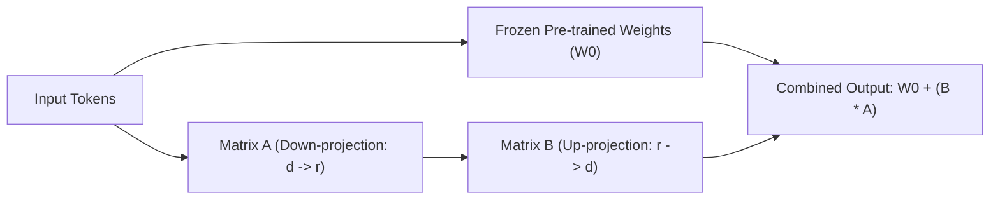

# 📘 অধ্যায় ৫: Open-Source LLMs & Fine-Tuning
> **বইয়ের ট্র‍্যাক:** AI Engineer, GenAI & Agentic Systems (Track 2)  
> **মডিউল:** ০৫ | ওপেন-সোর্স এলএলএম, PEFT, LoRA, QLoRA ও Unsloth ফাইন-টিউনিং  
> **উদ্দেশ্য:** নির্দিষ্ট ডোমেইনের ভাষা, টোন এবং কাস্টম ফরম্যাটে ওপেন-সোর্স মডেলকে কাস্টমাইজ করে লোকালি রান করা।

---

## 📑 সূচিপত্র (Table of Contents)
1. [ভূমিকা: কখন Fine-Tuning এবং কখন RAG?](#১-ভূমিকা-কখন-fine-tuning-এবং-কখন-rag)
2. [টপিক ১: Full Fine-Tuning বনাম PEFT](#২-টপিক-১-full-fine-tuning-বনাম-peft)
3. [টপিক ২: LoRA ও QLoRA আর্কিটেকচার](#৩-টপিক-২-lora-ও-qlora-আর্কিটেকচার)
4. [টপিক ৩: Unsloth — ফাস্ট ও লো-মেমোরি ট্রেনিং](#৪-টপিক-৩-unsloth--ফাস্ট-ও-লো-মেমোরি-ট্রেনিং)
5. [টপিক ৪: Dataset Preparation (Alpaca ও ShareGPT ফরম্যাট)](#৫-টপিক-৪-dataset-preparation)
6. [টপিক ৫: মডেল এক্সপোর্ট (GGUF) ও Ollama-তে সার্ভিং](#৬-টপিক-৫-মডেল-এক্সপোর্ট-gguf-ও-ollama-তে-সার্ভিং)

---

## ১. ভূমিকা: কখন Fine-Tuning এবং কখন RAG?

এআই ইঞ্জিনিয়ারদের সবচেয়ে বড় ভুল হলো না বুঝে শুরুতেই মডেল ফাইন-টিউনিং করতে যাওয়া। নিচের সিদ্ধান্ত ম্যাট্রিক্সটি মনে রাখুন:

| আপনার লক্ষ্য | প্রস্তাবিত সমাধান | কারণ |
| :--- | :--- | :--- |
| মডেলকে নতুন তথ্য বা প্রাইভেট ডেটা জানানো | **RAG** | তথ্যের পরিবর্তন হলে সহজেই ডাটাবেস আপডেট করা যায়, কম খরচ। |
| মডেলকে কথা বলার নির্দিষ্ট স্টাইল/টোন শেখানো | **Fine-Tuning** | প্রম্পট ছোট রাখা যায় এবং আচরণ স্থায়ী হয়। |
| সম্পূর্ণ নিজস্ব JSON/SQL স্কিমা শতভাগ নির্ভুলভাবে আউটপুট দেওয়া | **Fine-Tuning** | মডেল নির্দিষ্ট সিনট্যাক্সে অভ্যস্ত হয়ে যায়। |
| প্রাইভেসি নিশ্চিত করে ক্লাউড ছাড়াই সম্পূর্ণ লোকাল সার্ভারে মডেল রান করা | **Fine-Tuning + Ollama** | কোনো ডাটা ইন্টারনেটে যায় না। |

---

## ২. টপিক ১: Full Fine-Tuning বনাম PEFT

* **Full Fine-Tuning:** মডেলের সমস্ত প্যারামিটার (যেমন: ৭০ বিলিয়ন ওয়েট) আপডেট করা। এতে ডজনখানেক A100 GPU ও লাখ লাখ টাকার বিদ্যুত খরচ হয়, যা সাধারণ কোনো সফটওয়্যার প্রজেক্টের জন্য অপ্রয়োজনীয়।
* **PEFT (Parameter-Efficient Fine-Tuning):** মূল মডেলের ৯৯.৯% ওয়েট ফ্রিজ (লক) করে রাখা হয় এবং পাশে মাত্র ০.১% আকারের ছোট একটি অ্যাডাপ্টার লেয়ার যোগ করে শুধু সেটিকে ট্রেইন করা হয়।

---

## ৩. টপিক ২: LoRA ও QLoRA আর্কিটেকচার



### ৩.১ LoRA (Low-Rank Adaptation)
ম্যাট্রিক্স ডিকম্পোজিশন গণিত ব্যবহার করে বিশাল ডাইমেনশনের ওয়েটকে দুটি ছোট র‍্যাংক ম্যাট্রিক্সে ($B \times A$) ভাগ করা হয়। ফলে মেমোরি খরচ ৯০% কমে যায়।

### ৩.২ QLoRA (Quantized LoRA)
মূল মডেলের ওয়েটগুলোকে ১৬-বিটের বদলে ৪-বিট (NF4 Quantization) ফরম্যাটে মেমোরিতে লোড করা হয়। এর ফলে একটি সাধারণ ল্যাপটপ বা গেমিং জিপিইউতেই (যেমন: RTX 3060/4060) ৭ বা ৮ বিলিয়ন মডেল ফাইন-টিউন করা সম্ভব হয়!

---

## ৪. টপিক ৩: Unsloth — ফাস্ট ও লো-মেমোরি ট্রেনিং

২০২৫-২০২৬ সালে ওপেন-সোর্স এলএলএম ফাইন-টিউনিংয়ের সবচেয়ে সেরা লাইব্রেরি হলো **Unsloth**। এটি পাইথনের ট্রাইটন (Triton) কার্নেল ব্যবহার করে ম্যানুয়ালি ব্যাকপ্রোপাগেশন অপ্টিমাইজ করেছে:
* মেমোরি খরচ ৮০% কমায়।
* ট্রেনিং স্পিড ৫ গুণ বাড়িয়ে দেয়।
* LLaMA 3, Mistral, Gemma, Phi-3 সরাসরি সাপোর্ট করে।

---

## ৫. টপিক ৪: Dataset Preparation

ফাইন-টিউনিংয়ের সাফল্যের ৮০% নির্ভর করে ডেটাসেটের মানের ওপর। সবচেয়ে বেশি ব্যবহৃত হয় **Alpaca Format**:

```json
[
  {
    "instruction": "কোম্পানির রিটার্ন পলিসি অনুযায়ী গ্রাহক কত দিনের মধ্যে পণ্য ফেরত দিতে পারবে?",
    "input": "",
    "output": "গ্রাহক পণ্য গ্রহণের ৭ কার্যদিবসের মধ্যে ইনভয়েস সহ পণ্যটি অক্ষত অবস্থায় ফেরত দিতে পারবেন।"
  },
  {
    "instruction": "নিম্নোক্ত ত্রুটির কারণ ব্যাখ্যা করো:",
    "input": "IndexError: list index out of range",
    "output": "পাইথনে কোনো লিস্টের যে কয়টি উপাদান রয়েছে, তার চেয়ে বেশি ইনডেক্স অ্যাক্সেস করতে চাইলে এই ত্রুটি দেখা দেয়।"
  }
]
```

### Unsloth দিয়ে ট্রেনিং শুরু করার স্নিপেট:
```python
from unsloth import FastLanguageModel
import torch

# ১. ৪-বিট কোয়ান্টাইজড মডেল লোড করা
model, tokenizer = FastLanguageModel.from_pretrained(
    model_name="unsloth/llama-3-8b-bnb-4bit",
    max_seq_length=2048,
    load_in_4bit=True,
)

# ২. LoRA অ্যাডাপ্টার কনফিগারেশন
model = FastLanguageModel.get_peft_model(
    model,
    r=16, # LoRA Rank
    target_modules=["q_proj", "k_proj", "v_proj", "o_proj", "gate_proj", "up_proj", "down_proj"],
    lora_alpha=16,
    lora_dropout=0,
    bias="none",
)
```

---

## ৬. টপিক ৫: মডেল এক্সপোর্ট (GGUF) ও Ollama-তে সার্ভিং

ট্রেনিং শেষ হওয়ার পর অ্যাডাপ্টারটিকে মূল মডেলের সাথে মার্জ করে পিসিতে চালানোর মতো জনপ্রিয় **GGUF** ফরম্যাটে এক্সপোর্ট করা যায়:

```python
# GGUF 4-বিট কোয়ান্টাইজড ফরম্যাটে সেভ
model.save_pretrained_gguf("my_custom_model", tokenizer, quantization_method="q4_k_m")
```

### Ollama-তে লোকালি ডিপ্লয় করার নিয়ম:
১. একটি `Modelfile` তৈরি করুন:
```dockerfile
FROM ./my_custom_model-unsloth.Q4_K_M.gguf
SYSTEM "You are a specialized Bengali legal assistant."
PARAMETER temperature 0.2
```

২. টার্মিনালে এক কমান্ডে মডেল রেজিস্টার ও রান করুন:
```bash
ollama create legal-ai -f Modelfile
ollama run legal-ai
```
এখন আপনার সম্পূর্ণ নিজস্ব ফাইন-টিউনড মডেল আপনার পিসিতে অফলাইনে রেডি!
