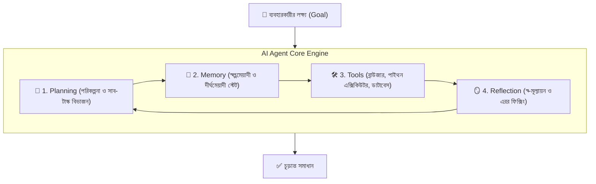
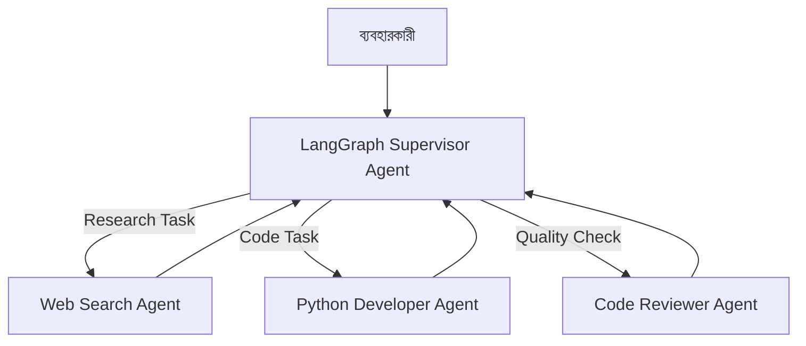

# 📘 অধ্যায় ৬: Agentic AI, LangGraph & Multi-Agent Systems
> **বইয়ের ট্র‍্যাক:** AI Engineer, GenAI & Agentic Systems (Track 2)  
> **মডিউল:** ০৬ | স্বয়ংক্রিয় এজেন্ট, LangGraph স্টেট মেশিন, হিউম্যান-ইন-দ্য-লুপ ও মাল্টি-এজেন্ট সিস্টেম  
> **উদ্দেশ্য:** শুধুমাত্র চ্যাট করার এআই নয়; বরং নিজে পরিকল্পনা করে, ডিসিশন নেয় এবং স্বয়ংক্রিয়ভাবে জটিল টাস্ক সম্পন্ন করে এমন অটোনোমাস সিস্টেম তৈরি করা।

---

## 📑 সূচিপত্র (Table of Contents)
1. [ভূমিকা: চ্যাটবট বনাম অটোনোমাস এআই এজেন্ট](#১-ভূমিকা-চ্যাটবট-বনাম-অটোনোমাস-এআই-এজেন্ট)
2. [টপিক ১: এজেন্টের ৪টি মূল স্তম্ভ (Planning, Memory, Tools, Reflection)](#২-টপিক-১-এজেন্টের-৪টি-মূল-স্তম্ভ)
3. [টপিক ২: কেন সাধারণ চেইন ফেইল করে এবং LangGraph কেন দরকার?](#৩-টপিক-২-কেন-সাধারণ-চেইন-ফেইল-করে-এবং-langgraph-কেন-দরকার)
4. [টপিক ৩: LangGraph আর্কিটেকচার (State, Nodes, Conditional Edges)](#৪-টপিক-৩-langgraph-আর্কিটেকচার)
5. [টপিক ৪: Persistence, Checkpointing ও Time-Travel Debugging](#৫-টপিক-৪-persistence-checkpointing-ও-time-travel)
6. [টপিক ৫: Human-in-the-Loop (মানবিক অনুমোদন গেট)](#৬-টপিক-৫-human-in-the-loop)
7. [টপিক ৬: Multi-Agent Teams (LangGraph Supervisor বনাম CrewAI)](#৭-টপিক-৬-multi-agent-teams)
8. [টপিক ৭: Vision & Web Agents (Browser-Use)](#৮-টপিক-৭-vision--web-agents)
9. [🎯 মাইলস্টোন প্রজেক্ট ৩: Autonomous Software Engineering Team](#৯-মাইলস্টোন-প্রজেক্ট-৩-autonomous-software-engineering-team)

---

## ১. ভূমিকা: চ্যাটবট বনাম অটোনোমাস এআই এজেন্ট

* **সাধারণ চ্যাটবট:** ব্যবহারকারী প্রশ্ন করে, এআই উত্তর দেয়। ইউজার বলল "আমার টিকিট কেটে দাও", চ্যাটবট বলবে "এই লিংকে গিয়ে টিকিট কাটুন।"
* **অটোনোমাস এজেন্ট:** এজেন্ট নিজেই লক্ষ্য (Goal) নিয়ে কাজ করে। সে গুগল ফ্লাইটে যাবে, সস্তা টিকিট খুঁজবে, ক্রেডিট কার্ড দিয়ে পেমেন্ট গেটওয়ে হ্যান্ডেল করবে এবং কনফার্মেশন পিডিএফ ইমেইলে পাঠিয়ে ইউজারকে জানাবে "টিকিট কাটা সম্পন্ন হয়েছে।"

---

## ২. টপিক ১: এজেন্টের ৪টি মূল স্তম্ভ



1. **Planning (পরিকল্পনা):** একটি বড় সমস্যাকে ছোট ছোট ধাপে ভাগ করা (Decomposition)।
2. **Memory (স্মৃতি):** আগের পদক্ষেপে কী হয়েছিল, কোন টুলের কী ফলাফল এসেছে তা মনে রাখা।
3. **Tools (টুলস):** এআই নিজে ক্যালকুলেটর, ওয়েব সার্চ, ডাটাবেস কোয়েরি বা শেল কমান্ড চালানোর ক্ষমতা রাখে।
4. **Reflection (আত্মপর্যালোচনা):** কোনো কোড লিখে এরর আসলে নিজেই সেই এরর পড়ে কোড সংশোধন করে আবার রান করা।

---

## ৩. টপিক ২: কেন সাধারণ চেইন ফেইল করে এবং LangGraph কেন দরকার?

LangChain-এর সাধারণ চেইনগুলো ছিল **Directed Acyclic Graph (DAG)**—অর্থাৎ শুধু সামনের দিকে যায়, পেছনে ফেরা যায় না।
কিন্তু বাস্তব জগতে:
* এআই পাইথন কোড লিখল -> কোড রান করল -> এরর আসলো -> **আবার আগের ধাপে ফিরে গিয়ে কোড ফিক্স করতে হবে (Cycle/Loop)।**
* সাধারণ চেইনে সাইকেল বানানো সম্ভব নয়। এই সমস্যার সমাধান করেছে **LangGraph**—যা একটি **Stateful Cyclic Graph Engine**।

---

## ৪. টপিক ৩: LangGraph আর্কিটেকচার (State, Nodes, Conditional Edges)

LangGraph মূলত তিনটি উপাদানের সমন্বয়ে গঠিত:
1. **State:** একটি টাইপড ডিকশনারি বা Pydantic মডেল যা গ্রাফের সমস্ত নোডের মধ্যে ডেটা শেয়ার করে।
2. **Nodes:** সাধারণ পাইথন ফাংশন যা বর্তমান State গ্রহণ করে এবং পরিবর্তিত State রিটার্ন করে।
3. **Edges & Conditional Edges:** এক নোড থেকে অন্য নোডে যাওয়ার পথ অথবা শর্তের ভিত্তিতে ব্রাঞ্চিং।

```python
from typing import TypedDict, Annotated
from langgraph.graph import StateGraph, END
import operator

# ১. স্টেট ডিফাইন করা
class AgentState(TypedDict):
    task: str
    code: str
    error: str | None
    is_success: bool

# ২. নোড ফাংশন তৈরি
def coder_node(state: AgentState):
    print("👨‍💻 Coder কোড তৈরি বা ফিক্স করছে...")
    return {"code": "def add(a, b): return a + b"}

def test_runner_node(state: AgentState):
    print("🧪 টেস্ট চালানো হচ্ছে...")
    # টেস্ট সিমুলেশন
    if "return a + b" in state["code"]:
        return {"error": None, "is_success": True}
    return {"error": "AssertionError", "is_success": False}

# ৩. শর্তসাপেক্ষ এজ (রাউটিং ডিসিশন)
def should_continue(state: AgentState):
    if state["is_success"]:
        return END # কাজ শেষ
    return "coder" # আবার কোড ঠিক করতে পাঠাও

# ৪. গ্রাফ তৈরি
workflow = StateGraph(AgentState)
workflow.add_node("coder", coder_node)
workflow.add_node("tester", test_runner_node)

workflow.set_entry_point("coder")
workflow.add_edge("coder", "tester")
workflow.add_conditional_edges("tester", should_continue)

app = workflow.compile()
```

---

## ৫. টপিক ৪: Persistence, Checkpointing ও Time-Travel Debugging

প্রোডাকশন সিস্টেমে কোনো এজেন্ট যদি মাঝপথে ক্র্যাশ করে, তবে পুরো টাস্ক নতুন করে শুরু না করে যেখানে থেমেছিল সেখান থেকে রিস্টার্ট করার জন্য LangGraph-এ **Checkpointer** (`MemorySaver` অথবা PostgreSQL) ব্যবহার করা হয়:

```python
from langgraph.checkpoint.memory import MemorySaver

memory = MemorySaver()
app = workflow.compile(checkpointer=memory)

# থ্রেড আইডি দিয়ে স্টেট রিকভারি
config = {"configurable": {"thread_id": "session_101"}}
final_state = app.invoke({"task": "Build add function"}, config=config)
```

---

## ৬. টপিক ৫: Human-in-the-Loop (মানবিক অনুমোদন গেট)

গুরুত্বপূর্ণ কাজের ক্ষেত্রে (যেমন: সার্ভার ডিলিট করা, টাকা ট্র্যান্সফার বা প্রোডাকশনে কোড পুশ) এআই যাতে নিজের ইচ্ছায় কিছু না করে, সেজন্য গ্রাফের এক্সিকিউশন পজ করে মানুষের কনফার্মেশন নেওয়ার জন্য `interrupt_before` মেকানিজম ব্যবহার করা হয়:

```python
# ডেপ্লয় করার নোডের আগে থামাও
app = workflow.compile(
    checkpointer=memory,
    interrupt_before=["deploy_to_production"]
)
```

---

## ৭. টপিক ৬: Multi-Agent Teams

### ৭.১ Supervisor Architecture
একজন কেন্দ্রীয় **Supervisor Agent** থাকে, যে ইউজারের গোল দেখে কাজ ভাগ করে দেয় এবং কর্মীদের কাজ মনিটর করে:



### ৭.২ CrewAI (Role-Playing Framework)
যদি দ্রুত রোল-প্লে ভিত্তিক টিম বানাতে চান, তবে CrewAI চমৎকার:
```python
from crewai import Agent, Task, Crew

researcher = Agent(
    role='Senior Market Analyst',
    goal='Find latest trends in AI hardware',
    backstory='Expert in semiconductor supply chains.'
)

writer = Agent(
    role='Tech Journalist',
    goal='Write a compelling newsletter',
    backstory='Award-winning tech writer.'
)

# টাস্ক ও ক্রু তৈরি করে run করা...
```

---

## ৮. টপিক ৭: Vision & Web Agents (Browser-Use)

২০২৬ সালের অন্যতম বড় অগ্রগতি হলো **Browser-Use**। এটি ভিশন মডেলকে (যেমন: GPT-4o / Claude 3.5) সরাসরি ক্রোম ব্রাউজারের সাথে কানেক্ট করে:
* পেজের স্ক্রিনশট দেখে কোন বাটন ক্লিক করতে হবে তা নিজে সিদ্ধান্ত নেয়।
* ফর্ম ফিলআপ, ক্যাপচা হ্যান্ডলিং এবং রিয়েল টাইম স্ক্র্যাপিং পরিচালনা করে।

---

## 🎯 ৯. মাইলস্টোন প্রজেক্ট ৩: Autonomous Software Engineering Team

**প্রজেক্ট গোল:** একটি স্বয়ংক্রিয় এআই টিম তৈরি করা যা একটি প্রবলেম স্টেটমেন্ট নিয়ে নিজে কোড লিখবে, টেস্ট চালাবে এবং সম্পূর্ণ তৈরি ফাইল গিটহাবে পুশ করবে।
* **Agent 1 (Researcher):** গুগল বা অফিসিয়াল ডক্স সার্চ করে সমাধান বের করবে।
* **Agent 2 (Software Engineer):** কোড ও PyTest স্ক্রিপ্ট লিখবে।
* **Agent 3 (QA Tester):** ভার্চুয়াল ডকার এনভায়রনমেন্টে কোড এক্সিকিউট করবে। বাগ পেলে এরর লগ সহ ইঞ্জিনিয়ারের কাছে পাঠাবে।
* **Human-in-the-loop Gatekeeper:** গিটহাবে পুশ করার আগে মানুষের অ্যাপ্রুভাল বাটন ক্লিক করার পরেই কেবল মার্জ করবে।
