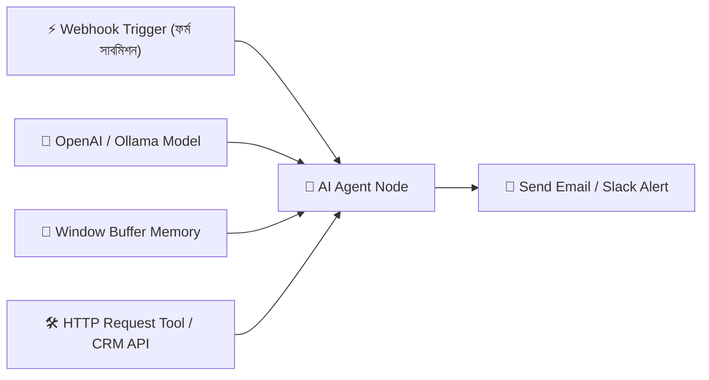

# 📘 অধ্যায় ৭: Enterprise AI Automation & Workflow Tools
> **বইয়ের ট্র‍্যাক:** AI Engineer, GenAI & Agentic Systems (Track 2)  
> **মডিউল:** ০৭ | এন্টারপ্রাইজ অটোমেশন, n8n এআই ওয়ার্কফ্লো, Crawl4AI ও ব্রাউজার স্ক্র্যাপিং  
> **উদ্দেশ্য:** তৈরি করা এআই এজেন্ট ও মডেলগুলোকে বাস্তব ব্যবসায়িক সিস্টেম, ডাটাবেস ও SaaS অ্যাপ্লিকেশনের সাথে স্বয়ংক্রিয়ভাবে সংযুক্ত করা।

---

## 📑 সূচিপত্র (Table of Contents)
1. [ভূমিকা: এন্টারপ্রাইজ অটোমেশন কেন আলাদা?](#১-ভূমিকা-এন্টারপ্রাইজ-অটোমেশন-কেন-আলাদা)
2. [টপিক ১: n8n — ওপেন-সোর্স এআই ওয়ার্কফ্লো অটোমেশন](#২-টপিক-১-n8n--ওপেন-সোর্স-এআই-ওয়ার্কফ্লো-অটোমেশন)
3. [টপিক ২: n8n-এ LangChain Agent ও Vector Store নোড কনফিগারেশন](#৩-টপিক-২-n8n-এ-langchain-agent-নোড)
4. [টপিক ৩: Modern Web Scraping for AI (Crawl4AI ও Playwright)](#৪-টপিক-৩-modern-web-scraping-for-ai)
5. [টপিক ৪: SaaS ও CRM ইন্টিগ্রেশন (Slack, Notion, HubSpot)](#৫-টপিক-৪-saas-ও-crm-ইন্টিগ্রেশন)
6. [🎯 মাইলস্টোন প্রজেক্ট ৪: Autonomous AI Lead Researcher & CRM Sync](#৬-মাইলস্টোন-প্রজেক্ট-৪-autonomous-lead-researcher)

---

## ১. ভূমিকা: এন্টারপ্রাইজ অটোমেশন কেন আলাদা?

একজন এআই ডেভেলপার হয়তো একটি দারুণ প্রম্পট বা LangGraph কোড লিখতে পারেন। কিন্তু বড় কোম্পানিগুলো চায়:
* ওয়েবসাইটে কোনো কাস্টমার ফরম পূরণ করলে সেই লিড স্বয়ংক্রিয়ভাবে এআই রিচার্স করুক।
* কোম্পানির সেলস সিআরএম (HubSpot/Salesforce)-এ তথ্য আপডেট হোক।
* সেলস টিমের স্ল্যাক চ্যানেলে নোটিফিকেশন যাক।

পুরো সিস্টেম প্রতিবার স্ক্র্যাচ থেকে কোডিং করার বদলে ভিজ্যুয়াল ওয়ার্কফ্লো ইঞ্জিন এবং আধুনিক এআই ক্রলার ব্যবহার করাই হলো ইন্ডাস্ট্রির স্ট্যান্ডার্ড।

---

## ২. টপিক ১: n8n — ওপেন-সোর্স এআই ওয়ার্কফ্লো অটোমেশন

Zapier বা Make-এর মতো প্ল্যাটফর্মের চেয়ে **n8n** এআই ইঞ্জিনিয়ারদের প্রথম পছন্দ কারণ:
1. **Self-Hosted ও ওপেন সোর্স:** নিজস্ব ডকার বা ক্লাউড সার্ভারে সম্পূর্ণ ফ্রিতে চালানো যায়, কোনো ডাটা লিকেজ হয় না।
2. **নেটিভ এআই ও LangChain সাপোর্ট:** n8n-এর ভেতর সরাসরি LangChain এজেন্ট নোড, ভেক্টর স্টোর এবং এলএলএম কানেক্টর বিল্ট-ইন রয়েছে।

### ডকারে এক কমান্ডে n8n রান করার নিয়ম:
```bash
docker run -d --name n8n -p 5678:5678 -v ~/.n8n:/home/node/.n8n n8nio/n8n
```
ব্রাউজারে `http://localhost:5678` ওপেন করলেই সম্পূর্ণ ভিজ্যুয়াল ড্র্যাগ-অ্যান্ড-ড্রপ ক্যানভাস পেয়ে যাবেন।

---

## ৩. টপিক ২: n8n-এ LangChain Agent নোড

n8n-এ একটি এআই এজেন্ট বানাতে মূলত ৪টি নোড একসাথে জোড়া দেওয়া হয়:



* **Trigger Node:** কখন ওয়ার্কফ্লো চলবে (যেমন: ইমেইল আসলে, বা নির্দিষ্ট সময়ে ক্রন জব হিসেবে)।
* **AI Agent Node:** এজেন্টের চিন্তা ও এক্সিকিউশন ইঞ্জিন।
* **Tools Node:** এজেন্টকে দেওয়া নির্দিষ্ট ক্ষমতা (যেমন: গুগল সার্চ, কাস্টম পাইথন স্ক্রিপ্ট বা এসকিউএল কোয়েরি)।

---

## ৪. টপিক ৩: Modern Web Scraping for AI (Crawl4AI ও Playwright)

সাধারণ স্ক্র্যাপার (যেমন: `requests` বা `BeautifulSoup`) এআই অ্যাপ্লিকেশনের জন্য কার্যকর নয় কারণ:
* আধুনিক ওয়েবসাইটগুলো জাভাস্ক্রিপ্ট (React/Next.js) দিয়ে রেন্ডার হয়।
* পুরো এইচটিএমএল-এ প্রচুর সিএসএস, স্ক্রিপ্ট ও অপ্রয়োজনীয় ট্যাগ থাকে যা এলএলএম-এর টোকেন অপচয় করে।

### ৪.১ Crawl4AI — দ্য আল্টিমেট এআই ক্রলার
এটি ২০২৬ সালের সেরা ওপেন সোর্স ওয়েব ক্রলার যা সম্পূর্ণ পেজকে লাইভ রেন্ডার করে ক্লিন মার্কডাউন (Clean Markdown) আউটপুট দেয়:

```python
import asyncio
from crawl4ai import AsyncWebCrawler

async def extract_clean_web_content(url: str):
    async with AsyncWebCrawler(verbose=True) as crawler:
        result = await crawler.arun(url=url)
        # সম্পূর্ণ ক্লিন মার্কডাউন যা সরাসরি এলএলএম প্রম্পটে দেওয়া যায়
        return result.markdown

# async def main():
#     markdown_text = await extract_clean_web_content("https://example.com")
#     print(markdown_text[:500])
```

---

## ৫. টপিক ৪: SaaS ও CRM ইন্টিগ্রেশন

এআই এজেন্টকে যেকোনো বিজনেসের সাথে ইন্টিগ্রেট করার তিনটি প্রধান মাধ্যম:
1. **Webhooks:** অন্য কোনো অ্যাপ্লিকেশনে ইভেন্ট ঘটলে রিয়েল-টাইমে এআই এজেন্টকে পিং করা।
2. **Slack / Discord Bots:** টিমের ইন্টারনাল কমিউনিকেশন চ্যানেলে এআই অ্যাসিস্ট্যান্ট যুক্ত করা।
3. **Notion & Airtable APIs:** এআই যে রিসার্চ বা রিপোর্ট তৈরি করে তা স্ট্রাকচার্ড টেবিল আকারে সেভ রাখা।

---

## 🎯 ৬. মাইলস্টোন প্রজেক্ট ৪: Autonomous AI Lead Researcher & CRM Sync

**ওয়ার্কফ্লো আর্কিটেকচার:**
1. **ট্রিগার:** নতুন কোনো ক্লায়েন্টের ওয়েবসাইটের লিংক n8n Webhook-এ আসল।
2. **স্ক্র্যাপিং:** Crawl4AI দিয়ে ক্লায়েন্টের প্রোডাক্ট পেজ ও অ্যাবাউট পেজের ডাটা মার্কডাউনে রূপান্তর করা হলো।
3. **এআই অ্যানালাইসিস:** GPT-4o বা LLaMA 3.2 দিয়ে কোম্পানির ভ্যালু প্রপোজিশন, কোম্পানির সাইজ এবং সম্ভাব্য ব্যথাবিন্দু (Pain Points) আইডেন্টিফাই করা হলো।
4. **CRM আপডেট:** HubSpot বা Google Sheet-এ ক্লায়েন্টের প্রোফাইল তৈরি হলো।
5. **ড্রাফট তৈরি:** সেলস টিমের জন্য একটি হাইপার-পার্সোনালাইজড ইমেইল ড্রাফট রেডি করে স্ল্যাকে নোটিফিকেশন পাঠানো হলো।
